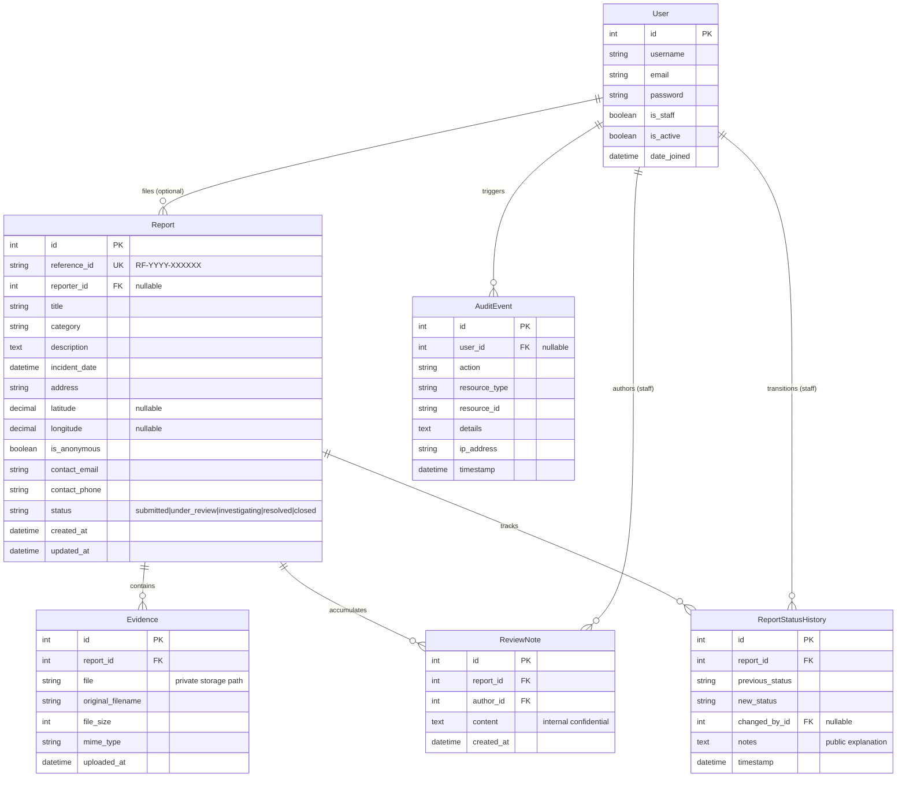
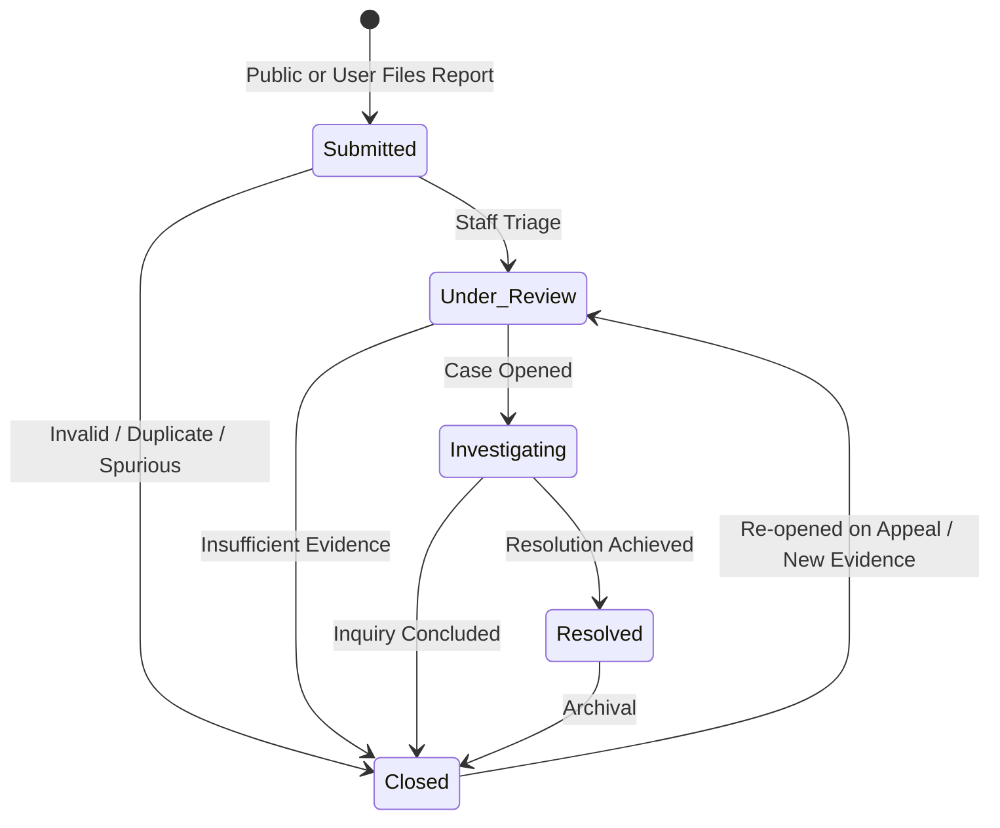

# redFlag: Data Model & Security Boundaries

**Project:** redFlag — Public Abuse & Civic Grievance Reporting System  
**Document:** `docs/DATA_MODEL.md`  

---

## 1. Entity Architecture

---

## 2. Field Specifications & Integrity Constraints

### 2.1 `Report` Model
- `reference_id`: CharField(max_length=32, unique=True, db_index=True)  
  - Format: `RF-` + Year + `-` + 6 uppercase cryptographic alphanumeric characters (e.g. `RF-2026-9K8M2T`).
  - Generated using `secrets.choice()` to prevent sequential enumeration attacks.
- `reporter`: ForeignKey(`auth.User`, on_delete=models.SET_NULL, null=True, blank=True, related_name='reports')
- `title`: CharField(max_length=150)
- `category`: CharField(max_length=50, choices=CATEGORY_CHOICES, db_index=True)
  - Categories:
    - `child_abuse`: "Child Abuse & Endangerment"
    - `domestic_violence`: "Domestic Violence"
    - `sexual_harassment`: "Sexual Harassment & Assault"
    - `drug_trafficking`: "Illicit Drug Trafficking"
    - `corruption_bribery`: "Corruption, Bribery & Misuse of Power"
    - `cyber_bullying`: "Cyber Harassment & Digital Crimes"
    - `robbery_theft`: "Robbery & Extortion"
    - `human_trafficking`: "Human Trafficking"
    - `other`: "Other Public Safety Grievance"
- `description`: TextField(max_length=5000)
- `incident_date`: DateTimeField() — Validated to not be in the future.
- `address`: CharField(max_length=255)
- `latitude`: DecimalField(max_digits=9, decimal_places=6, null=True, blank=True)
- `longitude`: DecimalField(max_digits=9, decimal_places=6, null=True, blank=True)
- `is_anonymous`: BooleanField(default=False)
- `contact_email`: EmailField(blank=True)
- `contact_phone`: CharField(max_length=30, blank=True)
- `status`: CharField(max_length=30, choices=STATUS_CHOICES, default='submitted', db_index=True)
  - `submitted`: Newly received, awaiting triage.
  - `under_review`: Assigned to staff, preliminary assessment ongoing.
  - `investigating`: Formal inquiry or referral to field unit.
  - `resolved`: Action concluded with findings or referral.
  - `closed`: Concluded, archived, or rejected with documented rationale.
- `created_at`: DateTimeField(auto_now_add=True, db_index=True)
- `updated_at`: DateTimeField(auto_now=True)

---

### 2.2 `Evidence` Model
- `report`: ForeignKey(`Report`, on_delete=models.CASCADE, related_name='evidence_files')
- `file`: FileField(upload_to='evidence/%Y/%m/')
- `original_filename`: CharField(max_length=255)
- `file_size`: PositiveIntegerField(help_text="File size in bytes")
- `mime_type`: CharField(max_length=100)
- `uploaded_at`: DateTimeField(auto_now_add=True)

---

### 2.3 `ReportStatusHistory` Model
- `report`: ForeignKey(`Report`, on_delete=models.CASCADE, related_name='status_history')
- `previous_status`: CharField(max_length=30)
- `new_status`: CharField(max_length=30)
- `changed_by`: ForeignKey(`auth.User`, on_delete=models.SET_NULL, null=True, blank=True)
- `notes`: TextField(blank=True, help_text="Public or reporter-visible outcome update")
- `timestamp`: DateTimeField(auto_now_add=True)

---

### 2.4 `ReviewNote` Model (Confidential Staff Notes)
- `report`: ForeignKey(`Report`, on_delete=models.CASCADE, related_name='internal_notes')
- `author`: ForeignKey(`auth.User`, on_delete=models.CASCADE)
- `content`: TextField(help_text="Internal confidential investigation note")
- `created_at`: DateTimeField(auto_now_add=True)

---

### 2.5 `AuditEvent` Model
- `user`: ForeignKey(`auth.User`, on_delete=models.SET_NULL, null=True, blank=True)
- `action`: CharField(max_length=100)
- `resource_type`: CharField(max_length=50)
- `resource_id`: CharField(max_length=50)
- `details`: TextField(blank=True)
- `ip_address`: GenericIPAddressField(null=True, blank=True)
- `timestamp`: DateTimeField(auto_now_add=True)

---

## 3. Workflow State Transitions

### Valid Transition Matrix

| From Status | Permitted To Status | Required Role | Justification / Notes Required |
| :--- | :--- | :--- | :--- |
| `submitted` | `under_review`, `closed` | Staff (`is_staff`) | Yes (Audit note) |
| `under_review` | `investigating`, `closed` | Staff (`is_staff`) | Yes (Audit note) |
| `investigating` | `resolved`, `closed` | Staff (`is_staff`) | Yes (Resolution summary) |
| `resolved` | `closed` | Staff (`is_staff`) | Optional |
| `closed` | `under_review` | Staff (`is_staff`) | Yes (Documented appeal reason) |

---

## 4. Privacy Boundaries & Access Control Rules

1. **Private by Default:**
   - Raw report records, complainant statements, contact details, and evidence are NEVER publicly listed.
   - Public endpoint `/reports/track/` accepts a reference ID and returns ONLY non-sensitive status metadata (`status`, `created_at`, `updated_at`, public resolution note from status history).
2. **Object-Level Ownership:**
   - Authenticated reporters can only view their own reports via `/dashboard/` (`filter(reporter=request.user)`).
   - Any attempt to access `/reports/<id>/` belonging to another user responds with HTTP 403 / 404.
3. **Internal Data Isolation:**
   - `ReviewNote` records are never exposed to public or reporter views; they are rendered solely in `/staff/reports/<id>/`.
4. **Secure Media Download:**
   - Uploaded evidence is stored outside the public document root.
   - Evidence download view `/staff/evidence/<id>/download/` verifies `request.user.is_staff` before streaming file with `FileResponse`.
   - Direct directory browsing of media files is prohibited.

